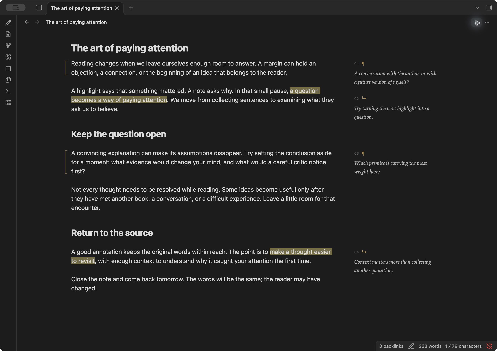
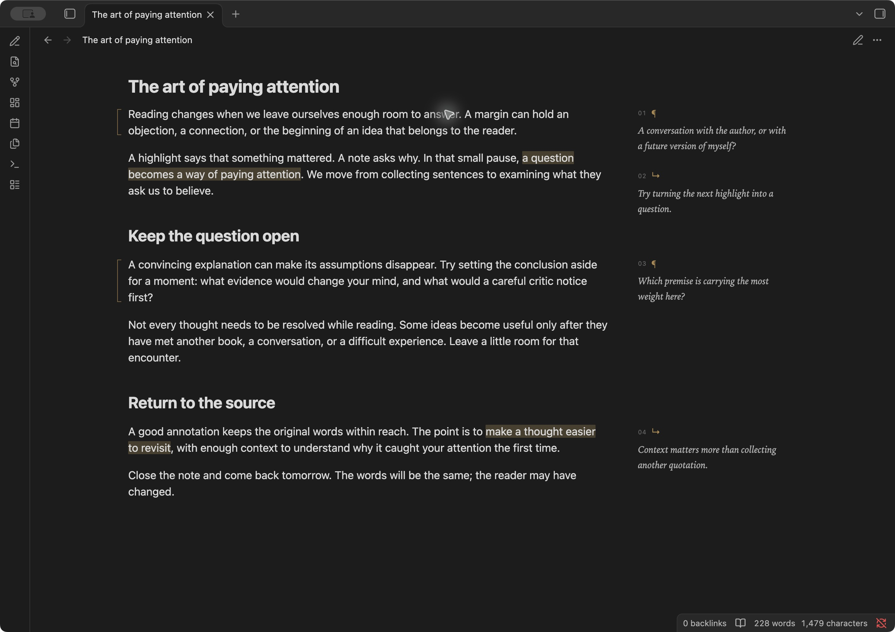

# Marginalia MD

Think beside the text. Write paragraph and passage notes in the margins of your ordinary Obsidian notes, with annotations that remain readable Markdown.



A fine bracket marks a whole paragraph. A soft highlight marks a passage. Small italic notes sit alongside the words they refer to, and move beneath their paragraph in narrow panes. Your theme controls the main text.

## Installation

Requires **Obsidian 1.14.4 or newer**. Desktop interactions have been tested; mobile has not yet been verified.

The release is prepared for Community Plugins submission. **Marginalia MD is not yet listed in the Community Plugins directory.**

### Install now with BRAT

Install [BRAT](https://github.com/TfTHacker/obsidian42-brat), add `lucapericlp/marginalia-md` as a beta plugin, and enable Marginalia MD under **Settings → Community plugins**. BRAT can install updates from this repository's releases.

### Manual installation

1. Download `marginalia-md-0.3.2.zip` from the [latest release](https://github.com/lucapericlp/marginalia-md/releases/latest).
2. Extract its `marginalia-md` folder into your vault's plugin directory, normally `<vault>/.obsidian/plugins/`.
3. Enable **Marginalia MD** under **Settings → Community plugins**. Reload the plugin after replacing an existing installation.

The release also provides `main.js`, `manifest.json`, and `styles.css` separately for Obsidian's installer. Saved comments live in your notes and survive updates. Community directory submission instructions are [here](docs/community-submission.md).

### Upgrading the previous private build

Disable the old **Marginalia** plugin before enabling **Marginalia MD**. Existing annotations remain compatible and need no changes. To retain unsaved drafts, disable the old plugin and copy its `data.json` into the new plugin folder before enabling the new version. Keep the old folder until you have confirmed the upgrade.

## Read and write

Annotations are available automatically in **every note**, in Live Preview, Source mode, and standard Reading view. No tags or special view are required. Your article stays in Obsidian's normal editor, including its Vim navigation, search, visual selection, insert mode, and undo.

- **A passage:** select words within one paragraph, then choose **Write in margin**.
- **A paragraph:** hover beside the paragraph and choose its pencil.
- **Write:** save the margin composer with **Save** or **⌘/Ctrl + Enter**. Escape cancels.
- **Edit:** hover over a note and choose its pencil. Reading view also supports keyboard focus on saved notes.
- **Remove:** use the delete control in the composer. The passage's highlight remains.

The pencil in the ribbon, editor context menu, and **Marginalia MD: Write in the margin** command provide the same action. In the editor, an empty selection uses the current paragraph; Vim visual selections work too. The margin composer is a regular textarea, while Vim continues to apply to the article.

Live Preview hides valid managed footnotes until your caret enters their source. Source mode shows all Markdown alongside the margin notes. In Reading view, comments can be added or edited without switching to another view. Unsaved drafts follow you when you switch views and are kept locally when a note closes.



Try the [example note](examples/The%20art%20of%20paying%20attention.md) in a test vault. It contains original demonstration text and four annotations.

## Ordinary Markdown underneath

Saved comments are standard Markdown footnotes. `mn-p-` identifies a paragraph note; `mn-s-` identifies a passage note. A passage uses Obsidian's readable `==highlight==` syntax.

```markdown
Reading is ==a conversation with the text==[^mn-s-conversation].

A margin leaves room for the reader to answer.[^mn-p-answer]

[^mn-s-conversation]: What would I ask the author?

[^mn-p-answer]: Return to this after reading the next chapter.
```

Comments support Markdown, links, and multiple paragraphs. Moving a paragraph with its reference moves its annotation. With Marginalia MD disabled, the note retains its highlights and conventional footnotes. Other Markdown readers with footnote support show ordinary endnotes; the references remain legible in plain text.

Rendering marginalia does not rewrite the article. Editor saves use native, undoable transactions and preserve the cursor in unchanged text. Reading view saves update the latest file atomically. If an anchored paragraph or comment has changed, saving stops with an explanation and keeps the draft.

## Privacy and storage

Marginalia MD requires no account, payment, server, or AI service. It makes no network requests and includes no analytics or telemetry. Obsidian may still load remote images or links contained in your note in its usual way.

Saved marginalia stays in the Markdown note and follows your existing vault sync. Unsaved drafts are stored in the plugin's local `data.json`; they are not a cross-device draft sync feature. The runtime uses Obsidian's vault APIs and does not access files outside the vault. Uninstalling the plugin leaves saved annotations in place.

## Boundaries

- Each annotation applies to one paragraph or list paragraph. Multi-paragraph selections are rejected.
- Overlapping passage notes are rejected to protect highlight syntax. Edit the existing note or annotate the whole paragraph instead.
- Formatted text and links work when a selection stays within a span or includes it completely. Partial inline-code selections are rejected.
- Missing, reused, ambiguous, or damaged anchors keep ordinary footnote rendering. Reading view also retains standard footnotes when it cannot place an annotation reliably.
- Transclusions and unusually transformed Markdown may not support precise passage anchoring.
- Native text editing uses Obsidian's regular undo; Reading view comment saves use the vault API.

## Development

Use Node.js 22.13 or newer.

```sh
npm ci
npm run lint
npm test
npm run build
npm run install:vault -- /absolute/path/to/a/test-vault
```

`npm run package` creates the Community Plugins assets, manual-install ZIP, licenses, and checksums in `dist/<version>/`. The build bundles runtime dependencies while leaving Obsidian and CodeMirror external. GitHub Actions validates changes and publishes releases from version tags without a `v` prefix. See [CONTRIBUTING.md](CONTRIBUTING.md) for the release process and [CHANGELOG.md](CHANGELOG.md) for changes.

The automated suite covers source preservation, selection mapping, formatting boundaries, conflicting edits, ambiguous anchors, native undo, and preservation of theme typography.

## License and acknowledgements

[MIT](LICENSE), copyright Luca Peric. Markdown parsing uses `mdast-util-from-markdown`, `mdast-util-gfm-footnote`, `micromark-extension-gfm-footnote`, and `decode-named-character-reference`; cursor-preserving edits use `diff`. Bundled dependencies retain their own licenses in [THIRD_PARTY_NOTICES.md](THIRD_PARTY_NOTICES.md), also embedded in `main.js`. Obsidian and CodeMirror are provided by Obsidian and are not bundled.
